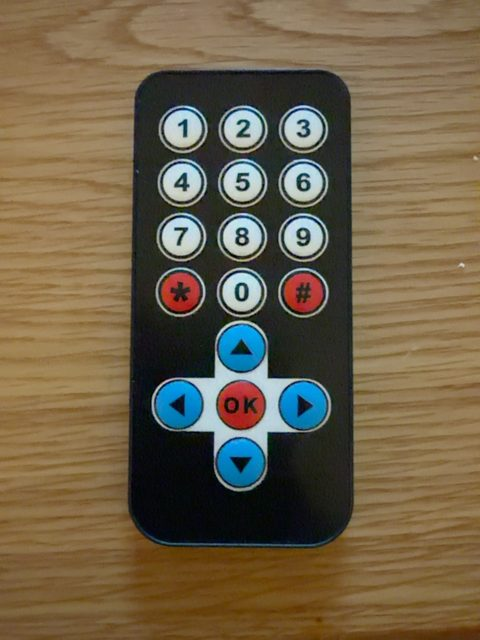

# Electrokit IR Remote — v1.1.0

A MakeCode extension for the 17-button Electrokit NEC remote and **BBC micro:bit V2**.



**for PXT/microbit**

## Install

MakeCode → Extensions → paste `https://github.com/raza-ui677/electrokit-ir-remote`.

Connect the receiver signal to **P0**, GND to **GND**, and power to the receiver's specified supply voltage.

## Blocks

**Setup:** `connect(pin)`, `setReleaseTimeout(ms)`.

**Conditions (Boolean, usable inside if/else, and/or, while, repeat until):**

- `isHeld(button)` — true while a button is active. `Any` checks any button.
- `isIdle()` — true when no button is active.
- `pressedRecently(button, window)` — true for a window after a press; not a one-shot event.
- `releasedRecently(button, window)` — true for a window after an estimated release; not a one-shot event.
- `heldFor(button, ms)` — true after a continuous hold of at least ms.
- `signalRecently(ms)` — true when a valid IR signal arrived recently.
- `isConnected()` — true once the decoder is initialized (not a hardware connectivity test).

**Events:** `onButtonPressed(button, callback)` and `onButtonReleased(button, callback)`.

**Timing:** `holdDuration()`, `timeSincePress()`, `timeSinceRelease()`, `releaseTimeout()`.

**Information:** `activeButton()`, `lastButton()`, `lastCommand()`, `lastReleasedButton()`, `rawCode()`, `buttonCode(button)`.

**Advanced:** `pressCount()`, `releaseCount()`, `repeatCount()`, `resetCounters()`.

## Example: conditional robot movement

```typescript
electrokitIR.connect(DigitalPin.P0)
electrokitIR.setReleaseTimeout(350)
basic.forever(function () {
    if (electrokitIR.isHeld(ElectrokitButton.Up)) {
        led.plot(2, 0) // replace with move-forward command
    } else {
        led.unplot(2, 0) // replace with motor stop
    }
    basic.pause(20)
})
```

## Behavior and limitations

- All 17 physical keys are mapped to their tested NEC commands.
- NEC has no explicit key-up message. Releases are estimated after no frames for the configured timeout.
- A `pressedRecently` / `releasedRecently` condition stays true during its window, so a `forever` loop may execute its body repeatedly. Use an event block or your own latch for exactly-once actions.
- Most NEC handsets cannot report two simultaneous button presses independently. Boolean AND of two held keys will not work like a computer keyboard.
- IR can be blocked or interfered with. Use a separate failsafe for hazardous actuators and moving robots.
- Do not attach multiple IR decoders to the same signal pin.
- Version 1.0.0's core NEC decoder and hold behavior were hardware-tested. New 1.1.0 blocks need testing on the actual board before a release tag is published.

## Files

`test.ts` is an optional hardware smoke-test program. `icon.png` is the 300 × 200 gallery artwork. `remote.jpg` is the real handset photo.

## License

MIT, see LICENSE.

## Human-readable button labels (v1.1.1)

The Information group includes string-valued blocks:
- **active Electrokit button name**: `UP`, `DOWN`, `LEFT`, `RIGHT`, `OK`, `0`–`9`, `*`, or `#` while held; `-` when idle.
- **last Electrokit button name**: remembers the most recently pressed key.
- **last released Electrokit button name**: remembers the last released key.
- **Electrokit button [Up] name**: converts a selected button to its label.

Example:
```typescript
electrokitIR.connect(DigitalPin.P0)
basic.forever(function () {
    let name = electrokitIR.activeButtonName()
    if (name != "-") {
        basic.showString(name)
    } else {
        basic.clearScreen()
    }
    basic.pause(100)
})
```
For a stable display without repeated scrolling, update the display only when the label changes.

## Single-symbol 5×5 display (v1.1.2)

The text label blocks now return `↑`, `↓`, `←`, `→` and `✓` for the direction and OK keys. These are suitable for Serial and string comparisons. **Do not use `basic.showString()` to render Unicode arrows/check marks on the LED matrix**: use the display blocks below instead.

- **show Electrokit button [Up] symbol** draws one static 5×5 symbol.
- **show held Electrokit button symbol** updates the 5×5 display only when the held key changes, and clears it on release. Place it inside `forever`.

```typescript
electrokitIR.connect(DigitalPin.P0)
electrokitIR.setReleaseTimeout(350)
basic.forever(function () {
    electrokitIR.showActiveButtonSymbol()
    basic.pause(30)
})
```

The 5×5 LED display can only show approximate `*` and `#` glyphs. For motors, avoid relying on infrared reception as the only safety stop.
